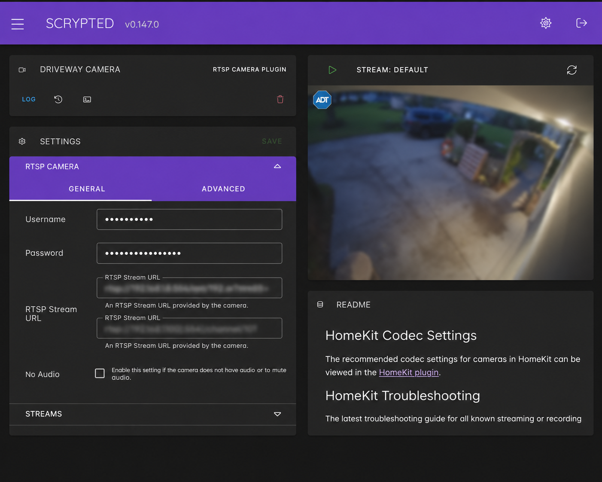
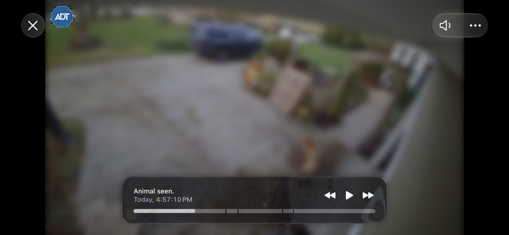

# Local RTSP for ADT Command / Alarm.com cameras

**Use locally streamed video from supported ADT-enrolled cameras without resetting or reflashing them.**

On November 15, 2026, we recovered the local camera credentials from an authenticated **ADT Control iOS** response and used them to connect to an **OC845** over ordinary **RTSP/TCP on port 554**. Its live video displayed in **Scrypted v0.147.0 running on Home Assistant OS**, without `socat`, MediaMTX, or a separate restreamer. We also displayed live streams from a second OC845 and an RC845 using the earlier TLS-relay method, and subsequently added both to Scrypted.

> **Important limitation:** Local *video transport* is verified. Operation with internet disconnected, after credential rotation, or after canceling ADT service is **not** verified. Don't cancel service on the strength of this guide alone.

## Proof of operation — tested on real cameras

**Tested November 15, 2026, on one active ADT Control installation:** two outdoor **OC845** cameras and one indoor **RC845**, all reporting firmware `V1.0.01R53`. The client used **Fedora 45** for investigation and **Scrypted v0.147.0 on Home Assistant OS** for the NVR integration. The cameras remained enrolled, and no firmware flashing or factory reset was needed.

These are observed hardware results, **not simulated output**. We distinguish a successful stream metadata probe from **visible live video**, and from **working recordings**:

| Device | Actual playback and integration evidence | Native motion experiment |
| --- | --- | --- |
| **OC845 A (driveway)** | Live video displayed in FFplay through the high-port TLS relay; direct authenticated **RTSP/TCP 554** identified H.264 **1920×1080** video and a **G.711 μ-law audio track**; **live picture displayed in Scrypted** using the RTSP Camera plugin, without a relay | In a **90-second** run: **1,337** decoded PIR samples, **8** trigger pulses, **3** software-held events |
| **OC845 B (lake)** | Live video displayed in FFplay through the TLS relay; a standalone client authenticated and received RTP directly on port **554**; subsequently added to Scrypted | In a **60-second** run: **882** PIR samples, **28** pulses, **4** software-held events |
| **RC845 (basement)** | Live video displayed in FFplay through the TLS relay; direct RTSP/TCP authentication and RTP confirmed; subsequently added to Scrypted | Related RTP padding metadata observed, but **no PIR command** in the tested stream |

### Visual proof from our installation

**1. Live Scrypted stream — driveway OC845.** This is the actual local video preview in **Scrypted v0.147.0**, using the **RTSP Camera** plugin on **Home Assistant OS**. The camera stream used direct, authenticated **RTSP/TCP on port 554**; it did not require the TLS relay for Scrypted.



*Figure 1. Real OC845 video displayed in Scrypted. Stream settings are redacted; the property view is blurred and the original ADT logo is still visible.*

**2. HomeKit Secure Video recording — driveway OC845.** This Apple Home screenshot shows a **recorded event**, labelled *“Animal seen.”* Our verified recording path used **Scrypted's OpenCV motion sensor and HomeKit integration**, not the experimental Sercomm PIR decoder. The ADT logo remains visible in the footage.



*Figure 2. A recorded HKSV event viewable in Apple Home. The property scene is blurred for privacy, while the ADT logo and playback controls remain readable.*

The screenshots document a **working local streaming and recording setup**, but neither image establishes operation without an internet connection or after ADT service cancellation.

**Recording proof:** Scrypted's **OpenCV Motion Sensor** triggered at least one real **HomeKit Secure Video** recording that was viewable in Apple Home, including an outdoor-camera event. We did **not** use the experimental native PIR monitor to trigger HKSV. An audio track being detected does **not** prove end-to-end audio playback in HomeKit.

**Our tested data path (simplified):**

```text
Authorized ADT Control response -> local credential extraction (one-time setup)
                                     |
Camera on trusted LAN -- RTSP/TCP :554 --> Scrypted RTSP Camera (HAOS)
                                          |
                                  OpenCV Motion Sensor
                                          |
                                   Scrypted HomeKit
                                          |
                                Apple Home / HKSV recording
```

The original camera-specific `lre` high port also worked through the [documented TLS relay](docs/TLS_FALLBACK.md), but the driveway's working Scrypted preview used **standard port 554** directly. The second OC845 and the RC845 were added to Scrypted; **per-camera preview, recording, and audio performance have not all been separately verified**.

**Reproducible technical evidence:** [investigation and observed media codecs](docs/DISCOVERY.md), [Scrypted configuration and HKSV observation](docs/nvr-scrypted.md), [native PIR packet samples and measured event counts](docs/NATIVE_PIR_FINDINGS.md), and the [per-camera compatibility record](COMPATIBILITY.md). The images above have connection details obscured and their property views blurred. Do not publish unredacted captures, camera-identifying details, or authenticated stream URLs.

> **Not proven:** operation without internet, after ADT subscription cancellation, or after credential rotation; long-term reliability; or full feature parity across all cameras. Our results are from **one installation**, not a compatibility guarantee.

## Start here

| I want to… | Read this |
| --- | --- |
| **Set this up from scratch**, including capture of the ADT response | **[Step-by-step how-to](docs/GETTING_STARTED.md)** |
| **Configure Scrypted on HAOS** using a saved capture | [Scrypted / NVR guide](docs/nvr-scrypted.md) |
| Understand **how we discovered this**, including failed approaches | [Investigation and technical findings](docs/DISCOVERY.md) |
| Explore experimental **native PIR / RTP padding** research | [Motion metadata findings](docs/NATIVE_PIR_FINDINGS.md) |
| Plan **reversible WAN isolation testing** before considering ADT cancellation | [Offline and subscription-independence test plan](docs/OFFLINE_TEST_PLAN.md) |
| Troubleshoot cameras that **don't accept standard RTSP on 554** | [Optional HTTPS-tunnel / `socat` fallback](docs/TLS_FALLBACK.md) |
| See tested models or contribute a result | [Compatibility](COMPATIBILITY.md) |
| Understand safe handling of credentials | [Security policy](SECURITY.md) |

### Already have a captured response?

No extra Python dependencies are required to use the interactive wizard:

```bash
python3 adc_setup_wizard.py
# Or supply the path instead of selecting it interactively:
python3 adc_setup_wizard.py --capture ~/adt-private/login-response.bin
```

Choose a camera by **number or IP**, keep the **standard RTSP port at 554** initially, then choose the output appropriate to your NVR. **Safe summary** is the default and displays no passwords or stream query tokens. The **Scrypted** mode shows separate URL/username/password fields; **NVR** mode can reveal a full credential-bearing URL. Sensitive outputs require typing `REVEAL` and can be saved only to a new private file. **This wizard does not capture ADT app traffic or obtain credentials on its own**; see the [how-to](docs/GETTING_STARTED.md) first.

## Scripts
| File | Purpose |
| --- | --- |
| [`adc_setup_wizard.py`](adc_setup_wizard.py) | **Recommended.** Interactive discovery, camera/IP selection, direct RTSP export, optional FFprobe test, and private file output |
| [`adc_local_test.py`](adc_local_test.py) | Safe camera listing and older high-port TLS relay probing/playback (no credentials printed) |
| [`adc_url_export.py`](adc_url_export.py) | Noninteractive advanced exports; explicitly reveals credential-bearing URLs |
| [`adc_motion_monitor.py`](adc_motion_monitor.py) | **Experimental, optional:** directly reads Sercomm PIR metadata from RTSP RTP padding; no video decoding |
| [`adc_mqtt.py`](adc_mqtt.py) | **Optional research only:** MQTT publisher; not validated against a real broker |

## Verified compatibility (one ADT installation)

| Camera | Evidence as of November 15, 2026 |
| --- | --- |
| **OC845 — driveway** | H.264 1920×1080 and G.711 μ-law audio detected; live FFplay; standard RTSP/TCP **554** probe; **live Scrypted preview on HAOS** |
| **RC845 — basement** | Live FFplay through TLS relay; added to Scrypted RTSP plugin |
| **OC845 — lake** | Live FFplay through TLS relay; added to Scrypted RTSP plugin |

After the original RTSP documentation was written, a **real HomeKit Secure Video recording was confirmed** through Scrypted/OpenCV and viewed in Apple Home (including motion outside the OC845's PIR range). This is a functional HKSV observation while the cameras and ADT service remained online, **not a long-term reliability or subscription-independence result**. Full audio and recording behavior on each individual camera were not separately validated. Models and firmware outside this installation are **not** yet validated. See [COMPATIBILITY.md](COMPATIBILITY.md) for the reporting template.

### Help expand compatibility

This project began as an experiment with three ADT cameras from one installation. We've confirmed local RTSP playback, Scrypted integration, HomeKit Secure Video recording, and experimental native PIR metadata decoding.

However, many questions remain unanswered, including compatibility with other camera models, firmware versions, and installations without active ADT subscriptions.

**If you have an ADT, Alarm.com, or Sercomm camera, we'd love to hear your findings!**

Whether your experiment succeeds or fails, your results could help others reuse their existing hardware.

Please open a GitHub issue with your camera model, firmware version, testing method, and results. Never share account credentials, authentication tokens, complete RTSP URLs, or unredacted API responses.

## Security and scope

This is for cameras and accounts **you own or are authorized to administer**. It requires your own authenticated ADT Control session; it is **not** a password bypass. The capture may include account tokens, session data, and reusable camera credentials. **Never upload the captured response, complete RTSP URLs, passwords, or mitmproxy certificates to a public repository or issue.** Even an RTSP URL without embedded username/password may contain a stream secret in its query.

Direct RTSP/TCP on port 554 is typically **unencrypted**. Keep it on a trusted LAN; **never forward RTSP ports to the internet**. If you use mitmproxy, remove its iPhone profile and Wi-Fi proxy and restore Lockdown Mode (if applicable) afterward.

## Research credit

This work builds on **dppeak's August 2026 research** in [Omar-L/adc-video-bridge issue #35](https://github.com/Omar-L/adc-video-bridge/issues/35). Our further findings include the ADT Control `UberSeamlessLoginNew` response, its gzip/XML camera attributes, the working high-port TLS fallback, and the simpler **direct port-554 Scrypted configuration**.

Read [the investigation](docs/DISCOVERY.md) for the sequence of experiments and limitations. Contributions are welcome via [CONTRIBUTING.md](CONTRIBUTING.md); please use only redacted or synthetic camera data.

## Optional motion research and the offline question

We reverse-engineered Sercomm's proprietary **RTSP RTP padding** and observed PIR pulses on **two OC845 units** with firmware `V1.0.01R53`. The indoor **RC845** provided a related metadata format but **no PIR command in our observations**. The standalone Python monitor was tested against the real outdoor cameras; [details, sample metadata, and limitations](docs/NATIVE_PIR_FINDINGS.md) are published for reproducibility. There is also a [read-only standalone monitor](docs/native-pir-experiment.md) and an [optional MQTT experiment](docs/native-pir-mqtt.md). **MQTT is not required**, and the pilot was not tested with an actual broker.

We deliberately **kept OpenCV as Scrypted's motion source for HKSV**: these wide-angle outdoor cameras cover cars, grass, and walkways beyond the OC845 PIR's specified ~5 m range. The PIR research is not a recommendation to reduce your existing recording coverage.

A related but unanswered question is whether local RTSP survives **camera-specific loss of internet, reboot without WAN, credential expiry, or ADT service cancellation**. These are **different tests**. The [reversible offline experiment plan](docs/OFFLINE_TEST_PLAN.md) explains how to check the first two cautiously without canceling ADT or disrupting a monitored security system. No independent or post-cancellation operation is claimed.
